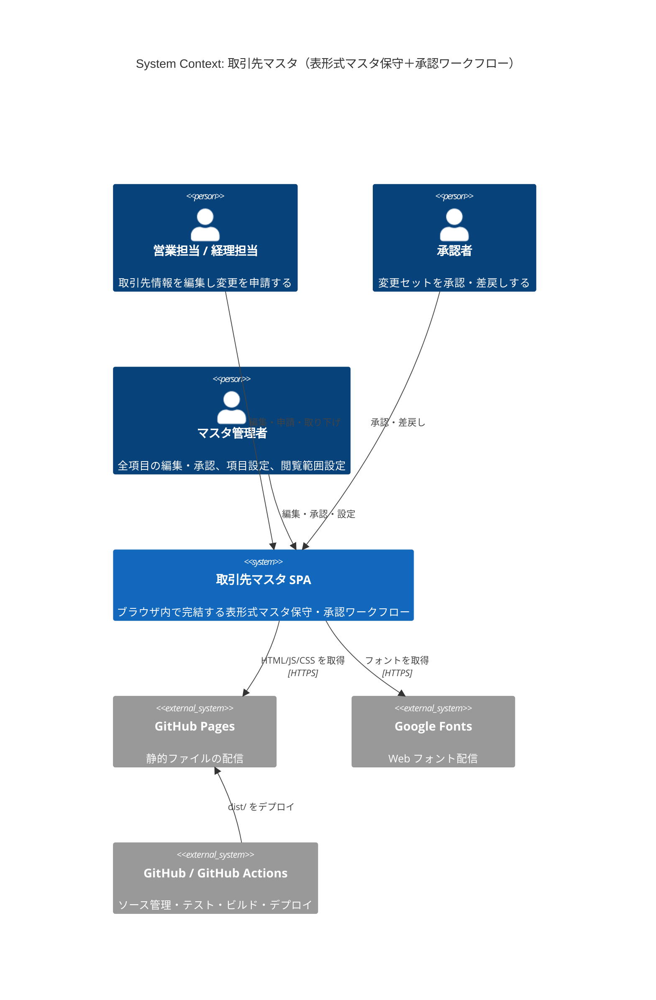
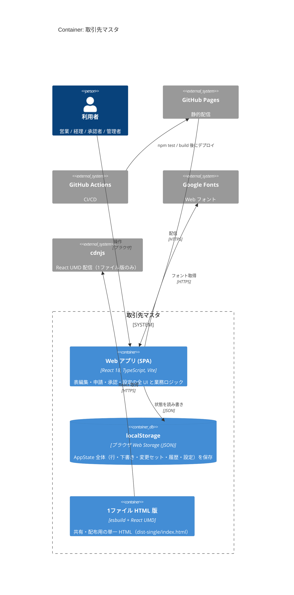
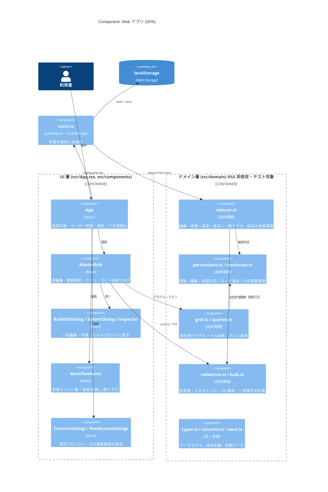
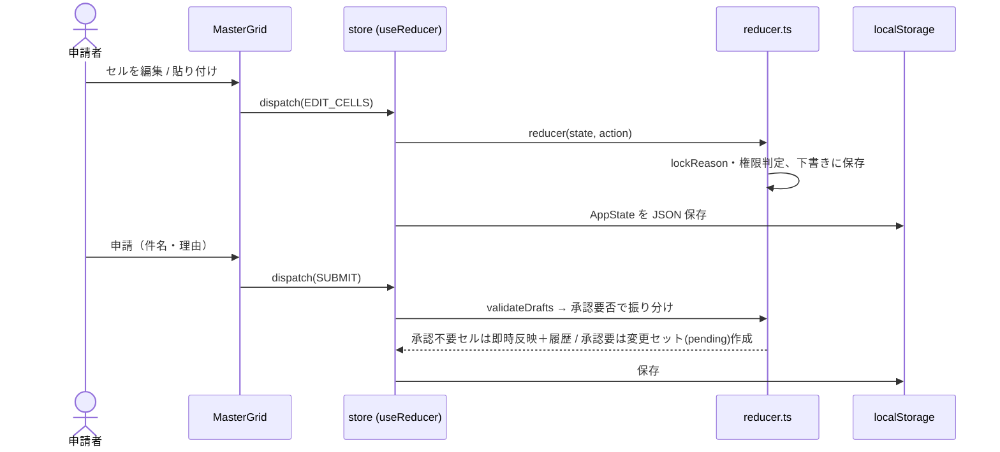
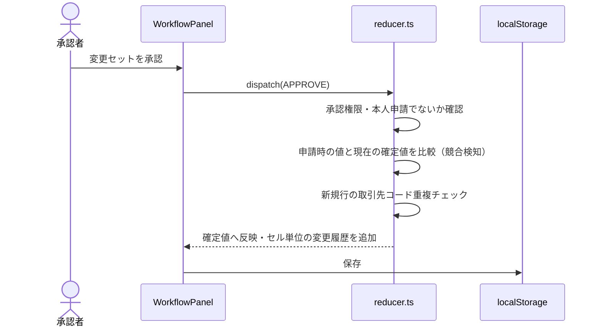

# アーキテクチャ（C4 モデル）

本書はリポジトリのコード（`package.json`、`vite.config.ts`、`scripts/build-single.mjs`、`.github/workflows/deploy-pages.yml`、`src/` 配下）を調査して作成したものです。コードから確認できない点は「未確認」と明記しています。

## 概要

| 項目 | 内容 |
| --- | --- |
| 目的 | 取引先マスタを Excel のような表で編集し、変更を「変更セット」単位で申請・承認するワークフローのプロトタイプ |
| 主な利用者 | 営業担当・経理担当（編集・申請）、承認者（承認・差戻し）、マスタ管理者（全編集・承認・項目設定・閲覧範囲設定）。画面右上のセレクトでロールを切り替えるデモ形式 |
| 実行形態 | ブラウザだけで完結する SPA。**バックエンド API・DB・認証基盤は存在しない**（状態はブラウザの `localStorage` に保存） |
| 配信 | GitHub Actions でビルドし GitHub Pages に公開。別途 `npm run build:single` で 1 ファイル HTML 版も生成可能 |

### 技術スタック

| 区分 | 技術 | 根拠 |
| --- | --- | --- |
| 言語 | TypeScript 5.8 | `package.json`, `tsconfig.json` |
| UI | React 18.3（`useReducer` による状態管理、外部状態管理ライブラリなし） | `package.json`, `src/store.ts` |
| ビルド | Vite 6 + `@vitejs/plugin-react` / esbuild（1ファイル版） | `vite.config.ts`, `scripts/build-single.mjs` |
| テスト | Node 標準テストランナー（`node --test`、Node 22.18+ の型除去） | `package.json` の `test` |
| 永続化 | ブラウザ `localStorage`（キー `torihikisaki-master:v1`） | `src/store.ts` |
| CI/CD | GitHub Actions → GitHub Pages | `.github/workflows/deploy-pages.yml` |
| 外部配信リソース | Google Fonts（IBM Plex Sans JP / Mono）、1ファイル版のみ cdnjs の React UMD | `index.html`, `scripts/build-single.mjs` |
| 認証 | なし（ユーザー切替は画面上のセレクト。実認証は未実装） | `src/App.tsx` |
| Docker / IaC | なし | リポジトリ内に該当ファイルなし |

---

## Level 1: System Context 図



| 名前 | 種別 | 技術 | 責務 |
| --- | --- | --- | --- |
| 営業担当 / 経理担当 | Person | — | 権限のある項目を編集し、変更セットとして申請する（申請者本人は承認不可） |
| 承認者 | Person | — | 承認待ちの変更セットを承認・差戻し。編集権限は持たない |
| マスタ管理者 | Person | — | 全編集・承認（自分の申請以外）、項目プロパティと行の閲覧範囲の設定 |
| 取引先マスタ SPA | Software System | React + TypeScript | マスタ編集、申請・承認ワークフロー、権限・閲覧範囲制御、監査履歴 |
| GitHub Pages | External System | 静的ホスティング | ビルド成果物の配信（`https://amonohno.github.io/customer-apply-prototype/`） |
| Google Fonts | External System | CDN | IBM Plex Sans JP / Mono の配信 |
| GitHub / GitHub Actions | External System | CI/CD | `main` への push でテスト→ビルド→Pages デプロイ |

> 業務システム（会計システム、法人番号・インボイス登録番号の照会 API 等）との連携はコード上に存在しない（未実装）。

---

## Level 2: Container 図



| 名前 | 種別 | 技術 | 責務 |
| --- | --- | --- | --- |
| Web アプリ (SPA) | Container | React 18 / TypeScript / Vite 6 | 画面（マスタ・ワークフロー・項目設定・閲覧範囲）と全業務ロジック。ハッシュ（`#master` 等）で画面切替 |
| localStorage | Container (DB) | Web Storage | `AppState` を JSON で丸ごと保存。読込失敗時はシードデータで起動 |
| 1ファイル HTML 版 | Container | esbuild（`scripts/build-single.mjs`） | アプリ JS/CSS をインライン化し、React を cdnjs から読む配布用 HTML |
| GitHub Pages | External | 静的ホスティング | `dist/` を配信（`--base=/<repo>/`） |
| GitHub Actions | External | `deploy-pages.yml` | `npm ci` → `npm test` → `npm run build` → Pages デプロイ |
| Google Fonts / cdnjs | External | CDN | フォント / React UMD の配信 |

> API サーバー・DB・オブジェクトストレージ・バッチ・認証基盤はいずれも存在しない。README には「API／DB を付ける場合は reducer の各アクションをサーバー側のユースケースに移す」方針が記載されている。

---

## Level 3: Component 図（Web アプリ SPA）



| 名前 | 種別 | 技術 | 責務 |
| --- | --- | --- | --- |
| App (`src/App.tsx`) | Component | React | ヘッダー（画面切替・承認バッジ・操作ユーザー切替）、通知トースト、デモ初期化 |
| MasterGrid (`components/MasterGrid.tsx`) | Component | React | 表編集、キーボード操作、範囲選択、クエリ・検索、クリップボード TSV 連携、申請ダイアログ起動 |
| BulkEditDialog / SubmitDialog / Inspector / Modal | Component | React | 一括入力・置換、申請（件名・理由・コメント）、選択セルのプロパティ・履歴表示 |
| WorkflowPanel (`components/WorkflowPanel.tsx`) | Component | React | 変更セットの一覧・詳細、承認・差戻し（理由必須）・取り下げ |
| ColumnSettings / RowAccessSettings | Component | React | 項目ごとの権限・必須・形式・承認要否等、ロール別の行閲覧範囲の編集（管理者のみ） |
| store.ts | Component | React `useReducer` | `reducer` で状態を更新し、変更のたびに `localStorage` へ保存 |
| reducer.ts | Component | TypeScript 純粋関数 | 全 `Action`（`EDIT_CELLS` / `ADD_ROW` / `SUBMIT` / `APPROVE` / `REJECT` / `WITHDRAW` / `UPDATE_COLUMN` / `*_ROW_ACCESS` 等）の状態遷移。職務分掌・競合検知・コード重複チェック |
| permissions.ts / rowAccess.ts | Component | TypeScript | 列の閲覧・編集権限、承認可否、セルのロック理由、ロール別の行閲覧条件 |
| grid.ts / queries.ts | Component | TypeScript | 確定値＋下書き＋承認待ちから表示用セル状態を算出、クエリ（行条件・表示項目・並び順）の適用 |
| validation.ts / bulk.ts | Component | TypeScript | 型変換・必須/正規表現/文字数チェック、TSV 解析、貼り付け・下へコピー・置換の計画 |
| types.ts / columns.ts / seed.ts | Component | TypeScript | `AppState` 等のデータモデル、取引先マスタの項目定義・ユーザー、デモ初期データ |

---

## 主要なデータフロー

### 1. セル編集 → 申請（変更セット作成）



### 2. 承認



差戻し（`REJECT`、理由必須）・取り下げ（`WITHDRAW`）では変更内容が申請者の下書きに戻る。

### 3. 起動時の状態読み込み

`store.ts` の `load()` が `localStorage['torihikisaki-master:v1']` を読み、`schema === 1` なら復元（閲覧範囲が無い旧データには既定値を補完）、それ以外や読込失敗時は `seed.ts` の `createInitialState()` で初期化する。

---

## ディレクトリ構成

```
.
├── .github/workflows/deploy-pages.yml  # main への push でテスト・ビルドし GitHub Pages に公開
├── docs/architecture.md                # 本書
├── index.html                          # Vite のエントリ HTML（Google Fonts 読み込み）
├── package.json / package-lock.json    # 依存とスクリプト（dev / build / build:single / test）
├── scripts/build-single.mjs            # 1ファイル HTML 版（dist-single/）を生成
├── tsconfig.json / vite.config.ts      # TypeScript / Vite 設定
└── src/
    ├── main.tsx                        # React エントリポイント
    ├── App.tsx                         # 画面全体（ヘッダー・画面切替・通知）
    ├── store.ts                        # useReducer + localStorage 永続化
    ├── styles.css                      # 全スタイル
    ├── components/                     # React UI コンポーネント
    └── domain/                         # UI 非依存の業務ロジック（*.test.ts でテスト）
```

| ディレクトリ | 役割 |
| --- | --- |
| `src/domain/` | データモデル、権限・閲覧範囲、入力チェック、状態遷移、表示モデル、クエリ、一括操作。React に依存せず `node --test` でテスト |
| `src/components/` | 表（MasterGrid）、ダイアログ、ワークフロー、設定画面などの React コンポーネント |
| `scripts/` | ビルド補助スクリプト（1ファイル HTML 生成） |
| `.github/workflows/` | GitHub Pages への CI/CD |
| `docs/` | 設計ドキュメント |

## 未確認・未実装事項

- 本番運用向けのバックエンド API、DB、認証・認可基盤：未実装（プロトタイプのため）
- 外部業務システムとの連携：未実装
- GitHub Pages の公開設定（Settings → Pages → Source）がリポジトリ側で有効化済みか：リポジトリ内からは未確認
